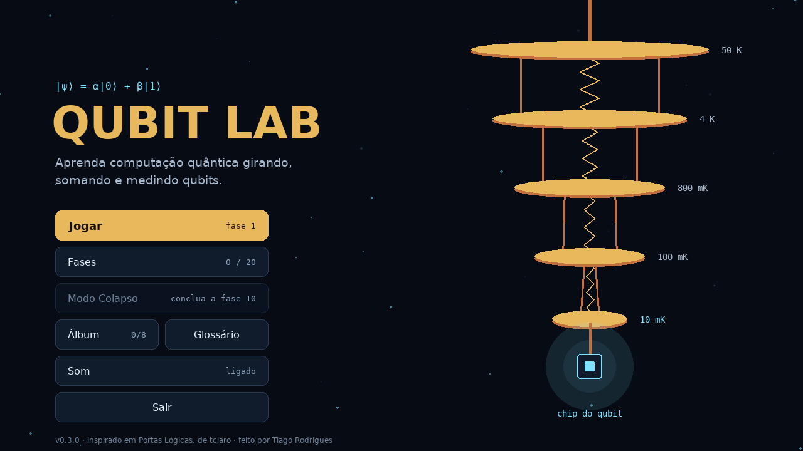
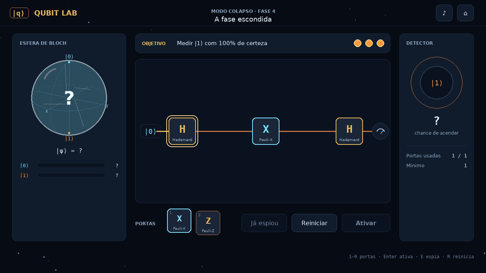
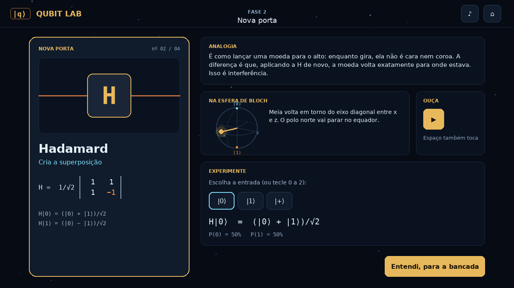
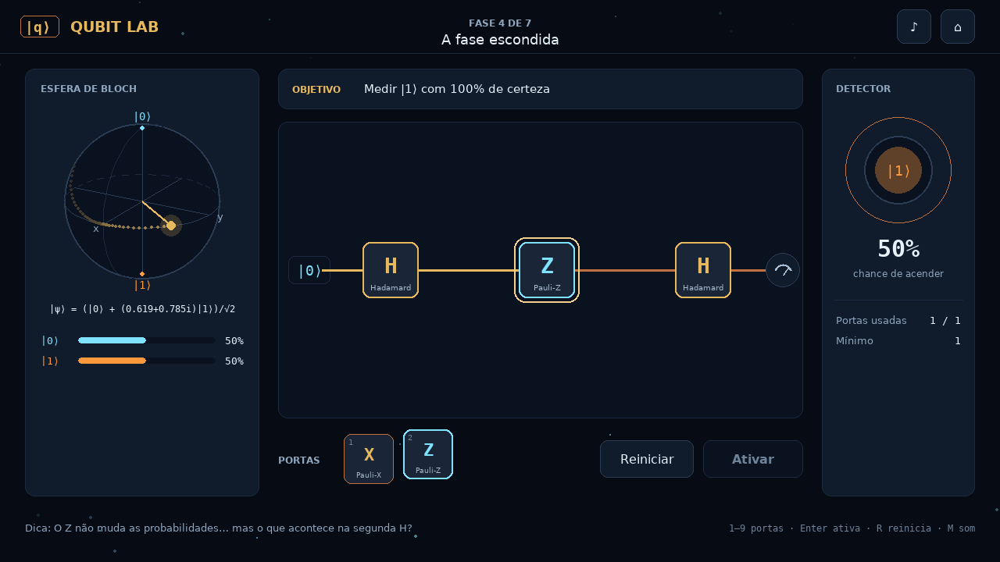
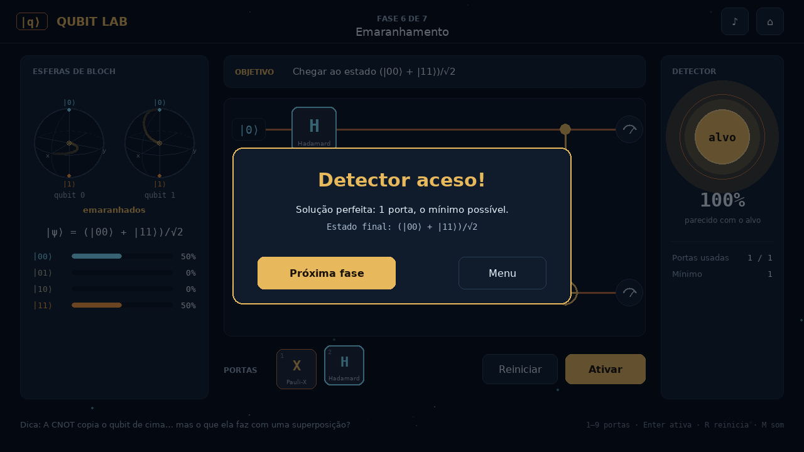
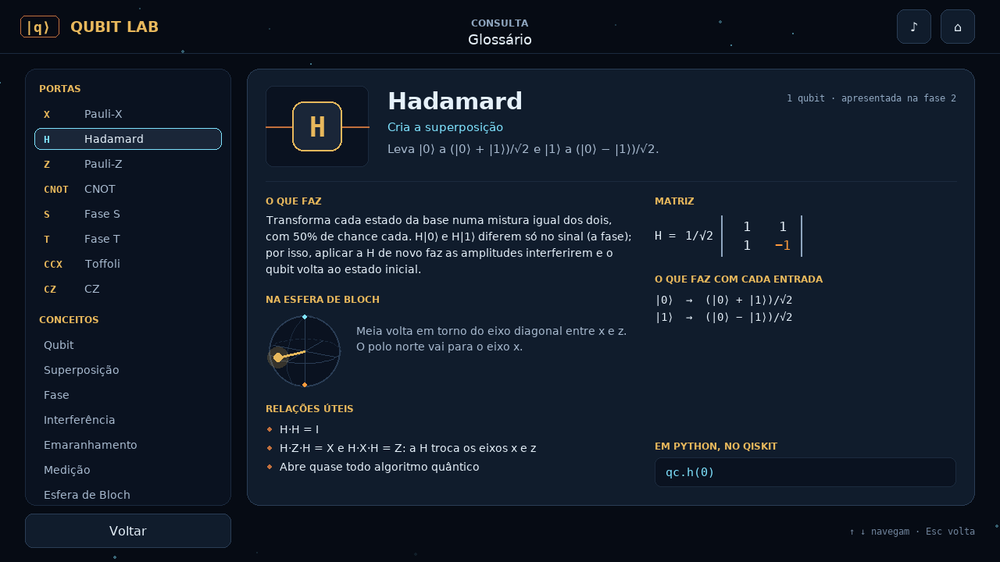

<div align="center">

# Qubit Lab

**Aprenda computação quântica girando, somando e medindo qubits dentro de um criostato.**

Um jogo em Python que ensina portas quânticas pela experiência: você monta o circuito, vê o qubit girar na esfera de Bloch e **ouve** a física acontecer.




</div>

---

## Índice

1. [A ideia](#-a-ideia)
2. [Como o jogo funciona](#-como-o-jogo-funciona)
3. [Progressão das fases](#-progressão-das-fases)
4. [Sons de física](#-sons-de-física)
5. [Instalação (Linux, Windows e macOS)](#-instalação)
6. [Como jogar](#-como-jogar)
7. [Glossário](#-glossário)
8. [Executável para download](#-executável-para-download)
9. [Para desenvolvedores](#-para-desenvolvedores)
10. [Roteiro](#-roteiro)
11. [Créditos](#-créditos)

---

## 💡 A ideia

Computação quântica costuma começar com matrizes e vetores complexos, o que afasta muita gente. O Qubit Lab inverte a ordem: **primeiro você mexe, vê e ouve; depois a matemática aparece como confirmação** do que você já percebeu.

O jogo acontece dentro de um laboratório criogênico, inspirado nos computadores quânticos reais, que funcionam a poucos milikelvin dentro de um refrigerador de diluição (o famoso "lustre dourado").

## 🧭 Como o jogo funciona

1. **O qubit começa em |0⟩** e o detector está apagado.
2. **Você coloca portas** (H, X, Z, …) nos slots do fio de cobre.
3. **Ao ativar, o estado evolui porta a porta**: a esfera de Bloch gira em tempo real e o som acompanha.
4. **O objetivo é acender o detector com 100% de certeza.** Não vale ganhar na sorte: se a chance for 50%, a fase não está resolvida.
5. **Antes de cada porta nova**, uma carta apresenta o símbolo, a matriz, uma analogia do dia a dia, a rotação na esfera, o som da porta e uma mini demonstração interativa.

### O que aparece na tela (a bancada)

| Área | O que mostra |
|---|---|
| Esfera de Bloch | O estado do qubit como um vetor, com o rastro do caminho percorrido e as probabilidades P(0) e P(1) |
| Circuito | O fio de cobre, as portas colocadas e os slots vazios |
| Bandeja | As portas disponíveis; as ainda não apresentadas aparecem com cadeado |
| Detector | A chance atual de acender e o número mínimo de portas para resolver a fase |

### Modo Colapso

Liberado depois de concluir a fase 10. É a prova de que você entendeu as portas, e não só as descobriu por tentativa:

- As esferas ficam **cobertas de gelo**: o estado, as probabilidades e a chance do detector ficam escondidos. É preciso simular o circuito de cabeça.
- A partida começa na fase 1 e segue em ordem, sem dicas.
- **Espiar** (botão ou tecla `E`), uma vez por fase: o circuito roda e o qubit é **medido uma única vez**. Você vê um resultado sorteado, como num experimento real, e o estado **colapsa**. Cuidado: num 50/50, uma medição só pode enganar.
- Ativar sem acender o detector **queima uma das 3 vidas**; o gelo quebra para você ver o que aconteceu.
- As vidas se renovam a cada fase vencida. Sem vidas, a partida volta ao início do capítulo (a fase em que a última porta nova apareceu).
- O menu mostra o seu **recorde**: a fase mais alta vencida no Modo Colapso.

<div align="center">

</div>

## 🪜 Progressão das fases

São **100 fases**, com 37 portas apresentadas uma de cada vez:

| Fases | Porta nova | Ideia central |
|:---:|---|---|
| 1 | **X** | O "NOT quântico": meia volta em torno do eixo x |
| 2–3 | **H** (Hadamard) | Superposição; e H·H desfaz a superposição (interferência) |
| 4–5 | **Z** | Fase: invisível nas probabilidades, decisiva na interferência |
| 6–7 | **CNOT** | Dois qubits e o primeiro **emaranhamento** (estado de Bell) |
| 8–10 | **S** | Um quarto de volta; duas S formam um Z |
| 11–14 | **T** | Um oitavo de volta; Bell com fase; desfazer o emaranhamento |
| 15–17 | **Toffoli** | O AND reversível e o estado GHZ de três qubits |
| 18 | | **Algoritmo de Deutsch**: uma consulta ao oráculo revela se ele é balanceado |
| 19 | **CZ** | **Busca de Grover** com 2 qubits: o oráculo marca \|11⟩ |
| 20 | | **Teleporte**: o estado do qubit 0 aparece no qubit 2 |
| 21 | **Y** | O giro em torno do eixo que faltava |
| 22–23 | **S†** e **T†** | As portas inversas: girar a fase no sentido contrário |
| 24–25 | | Desfazer em passos menores; Bell com fase imaginária |
| 26–30 | **√X** | Meio NOT: duas √X formam um X; a √X disfarçada (H·S·H) |
| 31–32 | **SWAP** | Troca o estado inteiro de dois qubits; a SWAP feita com três CNOTs |
| 33–34 | **iSWAP** | A troca com um i de fase; duas iSWAP não se desfazem |
| 35 | **Fredkin** (CSWAP) | A troca com chave: só troca se o controle for 1 |
| 36–38 | **CY** e **CH** | Controladas genéricas: Bell com um i; superposição pela metade; a CY feita com CNOT |
| 39–40 | **CCZ** | A marca de fase para três; o GHZ feito com CCZ |
| 41–45 | **Rx, Ry, Rz, P** (π/2) | Rotações com ângulo fixo; a Ry gira sem espelhar; Rz e S, iguais a menos de fase global; H·Rz·H = Rx |
| 46–50 | **CP, CRz, CRx, CRy** (π/2) | Rotações controladas; controlada, a fase global vira fase local |
| 51–57 | **Ising Rxx, Ryy, Rzz** (π/2) | Bell numa porta só; Rzz montada com CNOTs; de ZZ para XX com H; Rxx e Ryy formam uma troca |
| 58–62 | **√SWAP** | Meia troca; voltar da meia troca; igual à Rxx só às vezes; a CZ de meia troca |
| 63–68 | **U, CU e I** | Cartas U com ângulos diferentes, cada uma igual a uma porta conhecida (H, X, S, CNOT, CH); a I e a regra "todos os slots" |
| 69–74 | **MCX** (4 qubits) | O AND de três; GHZ de quatro; controle invertido; a Z de muitos controles; o retorno de fase |
| 75–82 | **Revisão por tradução** | Sem portas novas: X, Z, CNOT, S, Bell, Y e Rxx montados com outras portas |
| 83–92 | **Algoritmos** | Deutsch–Jozsa, Bernstein–Vazirani, Grover, codificação superdensa, QFT, estimativa de fase e troca de emaranhamento |
| 93–100 | **Desafios finais** | Bandeja cheia, orçamento de portas, teleporte do zero, Grover de 3 qubits e correção de erros |

Toda fase é verificada automaticamente: um validador confirma que ela tem solução, que só usa portas já apresentadas, e calcula o número mínimo de portas.

## 🔊 Sons de física

O som do Qubit Lab **não é decoração: é o próprio estado quântico.**

- |0⟩ é um **Lá** (220 Hz) e |1⟩ é um **Mi** (330 Hz).
- O áudio é `s(t) = Σ Re(aₖ(t) · Wₖ(t))`: as amplitudes do qubit controlam as notas diretamente. Como a potência do som é proporcional a |aₖ|², o volume de cada nota segue a probabilidade de medi-la.
- Em superposição você ouve as duas notas. Na interferência, as ondas **se cancelam de verdade** e uma nota some.
- A fase relativa vira posição no fone (estéreo) e brilho do timbre.
- Na medição, o acorde se quebra como vidro e sobra uma nota só.

Todos os sons são gerados por código em `ferramentas/gerar_sons.py`, sem nenhum arquivo de terceiros.

## 💻 Instalação

O jogo roda em **Linux, Windows e macOS**. Você precisa do **Python 3.10 ou mais novo** ([python.org/downloads](https://www.python.org/downloads/)).

> Quer só jogar, sem instalar Python? Veja [Executável para download](#-executável-para-download).

### 1. Baixe o projeto

```bash
git clone https://github.com/TiagoRodriguesskt/Qubit_Lab.git
cd Qubit_Lab
```

Ou baixe o ZIP pelo botão **Code → Download ZIP** no GitHub e extraia.

### 2. Crie um ambiente virtual e instale as dependências

**Linux e macOS**

```bash
python3 -m venv .venv
source .venv/bin/activate
pip install -r requirements.txt
```

**Linux com o terminal fish**

```fish
python3 -m venv .venv
source .venv/bin/activate.fish
pip install -r requirements.txt
```

**Windows (PowerShell)**

```powershell
py -m venv .venv
.venv\Scripts\Activate.ps1
pip install -r requirements.txt
```

> No Windows, se o PowerShell bloquear a ativação, rode uma vez:
> `Set-ExecutionPolicy -Scope CurrentUser RemoteSigned`

### 3. Rode o jogo

```bash
python main.py
```

O ambiente virtual (`.venv`) mantém as bibliotecas do jogo separadas do resto do seu Python. Nas próximas vezes, basta ativá-lo (passo 2, segunda linha) e rodar `python main.py`.

Para testar qualquer fase sem jogar as anteriores, use `python main.py --liberar`: todas as fases e o Modo Colapso ficam liberados só naquela execução, e o seu progresso salvo não muda.

### Dependências (`requirements.txt`)

| Biblioteca | Para quê |
|---|---|
| `numpy` | Simulador quântico: vetores de estado e matrizes das portas |
| `pygame-ce` | Janela, gráficos e som. É a versão "community" do Pygame, mais atualizada e com suporte às versões novas do Python. No código continua sendo `import pygame`. |

## 🎮 Como jogar

> **Versão atual: 1.0.** 100 fases, Modo Colapso, Álbum e Glossário (com a seção "Outras portas").

1. No menu, **Jogar** abre a próxima fase não concluída; **Fases** mostra todas (cada uma libera a seguinte); **Álbum** guarda as cartas já conquistadas; **Glossário** explica todas as portas e os conceitos (veja abaixo).
2. Toda fase começa por uma **explicação**, mesmo que você já a tenha concluído. Se a fase apresenta uma porta nova, é a **carta** da porta (matriz, analogia, rotação animada na esfera, som e uma demonstração para testar entradas). Nas outras, uma tela explica a ideia física da fase, o objetivo e mostra aonde o qubit precisa chegar. Durante a fase, o botão **?** (ou a tecla `I`) reabre a explicação sem perder as portas que você já colocou.
3. Na **bancada**, escolha uma porta na bandeja e clique num slot do circuito. Clicar num slot ocupado tira a porta.
4. **Ativar** roda o circuito: um pulso de energia percorre os fios, a esfera de Bloch gira em cada porta e o som acompanha o estado.
5. Se o detector acender com 100%, a fase está vencida. Se não, ele mostra a chance que você conseguiu.

<div align="center">

| Carta de porta nova | Bancada em ação | Estado de Bell |
|:---:|:---:|:---:|
|  |  |  |

</div>

| Tecla | Ação |
|---|---|
| `1` a `9` | Escolhe a porta da bandeja (na carta: escolhe a entrada) |
| `Enter` | Ativa o circuito / vai para a próxima fase |
| `R` | Reinicia a fase (tira todas as portas) |
| `Espaço` | Na carta, toca o som da porta |
| `I` | Abre a explicação da fase (no Modo Colapso não há explicação) |
| `G` | Abre o glossário (também pelo botão do livro; fora do Modo Colapso) |
| `E` | Modo Colapso: espia (mede uma vez) |
| `M` | Liga/desliga o som |
| `ESC` | Volta ao menu (no menu, sai do jogo) |

O progresso fica salvo na pasta do usuário (`~/.qubit_lab` no Linux/macOS, `C:\Users\<nome>\.qubit_lab` no Windows).

## 📖 Glossário

Uma referência de todas as portas do jogo (X, H, Z, CNOT, S, T, Toffoli, CZ, Y, S†, T†, √X, SWAP, iSWAP, Fredkin, CY, CH, CCZ, as rotações Rx, Ry, Rz e P e as controladas delas, as portas de Ising Rxx, Ryy e Rzz, a √SWAP, a identidade I, as portas U e CU com vários ângulos e a X multicontrolada) e dos conceitos principais (qubit, superposição, fase, interferência, emaranhamento, medição e esfera de Bloch) e dos algoritmos (oráculo, retorno de fase, codificação superdensa, QFT, estimativa de fase e troca de emaranhamento, cada um com as fases onde aparece). Ao contrário do Álbum, ele mostra tudo desde o início.

Todas as portas do simulador agora aparecem nas fases, então a seção "Outras portas" saiu do Glossário.

Para cada porta: o que ela faz, a rotação animada na esfera de Bloch, a matriz, o que acontece com cada entrada, relações úteis (como H·H = I) e o comando equivalente no **Qiskit**, a biblioteca de computação quântica em Python.

- No jogo: botão **Glossário** no menu, ou o botão do livro na bancada (tecla `G`), que volta para a fase sem perder as portas colocadas.
- No repositório: [`docs/GLOSSARIO.md`](docs/GLOSSARIO.md), gerado a partir dos mesmos textos por `python ferramentas/gerar_glossario.py`.

<div align="center">

</div>

## 📦 Executável para download

Sim, dá para jogar **sem instalar Python**. O projeto usa o **PyInstaller**, que empacota o Python, as bibliotecas e os sons num único programa.

### Baixar pronto

Quando houver uma versão publicada, os executáveis ficam na página **Releases** do repositório:

| Sistema | Arquivo | Como abrir |
|---|---|---|
| Windows | `QubitLab-windows.zip` | Extraia e dê dois cliques em `QubitLab.exe` |
| macOS | `QubitLab-macos.zip` | Extraia e abra `QubitLab.app` |
| Linux | `QubitLab-linux.tar.gz` | Extraia, rode `chmod +x QubitLab` e depois `./QubitLab` |

**Avisos de segurança na primeira vez** (normais para programas sem assinatura digital paga):

- **Windows:** o SmartScreen pode mostrar "O Windows protegeu o computador". Clique em **Mais informações → Executar assim mesmo**.
- **macOS:** o Gatekeeper pode bloquear. Clique com o botão direito no app → **Abrir** → **Abrir**.

### Gerar o executável você mesmo

```bash
pip install -r requirements-dev.txt
python ferramentas/gerar_executavel.py
```

O resultado fica em `dist/` (`QubitLab`, `QubitLab.exe` ou `QubitLab.app`, conforme o sistema). O arquivo tem por volta de 45 MB, porque leva o Python e o NumPy junto.

> O PyInstaller só gera executável para o sistema em que está rodando: o `.exe` precisa ser feito num Windows, o `.app` num Mac. Para gerar os três de uma vez, use o GitHub Actions (abaixo).

### Gerar os três automaticamente no GitHub

O arquivo `ferramentas/ci/build-executaveis.yml` faz o GitHub gerar e publicar os executáveis de Linux, Windows e macOS sozinho:

1. Copie-o para `.github/workflows/build-executaveis.yml`.
2. Envie para o GitHub.
3. Crie uma tag de versão:
   ```bash
   git tag v1.0.0
   git push origin v1.0.0
   ```
4. Em alguns minutos, os três arquivos aparecem em **Releases**, prontos para qualquer pessoa baixar.

## 🛠️ Para desenvolvedores

```bash
source .venv/bin/activate              # Windows: .venv\Scripts\Activate.ps1
pip install -r requirements-dev.txt   # dependências + pytest + pyinstaller
python -m pytest                       # roda os testes
python main.py --liberar               # todas as fases liberadas (para testar)
python main.py --teste                 # abre, desenha 30 quadros e fecha
python ferramentas/gerar_sons.py       # gera de novo os sons em assets/sons/
```

### O simulador quântico

O núcleo (`qubit_lab/core/`) não depende da parte gráfica e pode ser usado sozinho, num terminal ou num Jupyter:

```python
from qubit_lab.core import Circuito, Estado, PORTAS

bell = Circuito(2).adicionar("H", [0]).adicionar("CNOT", [0, 1]).executar()
print(bell)               # Estado((|00⟩ + |11⟩)/√2)
print(bell.bloch(0))      # [0. 0. 0.]  → emaranhado: o vetor de Bloch "some"
print(bell.pureza(0))     # 0.5

e = Estado.zeros(1).aplicar(PORTAS["H"], [0])
print(e.bloch(0))         # [1. 0. 0.]  → o qubit está no equador, eixo x
resultado, depois = e.medir(0)   # sorteia 0 ou 1 e colapsa o estado
```

Convenções:

- **Ordem dos qubits:** o qubit 0 é o da esquerda no ket (`|01⟩` = qubit 0 em 0, qubit 1 em 1). Na CNOT, `alvos=[controle, alvo]`.
- **Animação:** cada porta U é aplicada como Uᵗ, com t de 0 a 1 (`Circuito.animar`), então a esfera gira de forma contínua em vez de pular. É a mesma ideia usada para gerar os sons.
- **Emaranhamento:** a esfera de cada qubit usa a matriz densidade reduzida. Se o qubit estiver emaranhado, o vetor de Bloch fica mais curto que 1 (no estado de Bell, ele vai a zero).

### Criando fases

Cada fase é um JSON em `assets/fases/`:

```json
{
  "id": 4,
  "titulo": "A fase escondida",
  "qubits": 1,
  "circuito": [
    { "porta": "H", "alvos": [0] },
    { "slot": true, "alvos": [0] },
    { "porta": "H", "alvos": [0] }
  ],
  "disponiveis": ["X", "Z"],
  "objetivo": { "tipo": "probabilidade", "ket": "1" },
  "dica": "O Z não muda as probabilidades… mas o que acontece na segunda H?"
}
```

- `"explicacao"` (opcional) é o texto da tela de explicação; fases que apresentam uma porta nova usam a carta da porta no lugar.
- `"completo": true` (opcional) exige uma porta em cada slot: só vence quem preencher todos. É o que permite a fase da I (68), em que o circuito já começa no alvo.
- `"max_portas"` (opcional) é um orçamento: só vence quem chegar ao alvo com no máximo essa quantidade de portas (fase 94).
- `"minimo"` (opcional, dentro de `"objetivo"`) baixa a certeza exigida, para quando 100% não existe (fase 97: Grover com 3 qubits, 78%).
- `"formula"` (opcional, dentro de `"objetivo"`) escreve à mão um estado-alvo longo, como `(|0000⟩ + … − |1111⟩)/4`. Só muda o texto: a vitória continua conferida pelo vetor `"alvo"`, e um teste garante que os dois batem.
- Passos com `"porta"` vêm fixos; passos com `"slot": true` são preenchidos pelo jogador com uma das portas `disponiveis` (ou ficam vazios).
- A bandeja (`disponiveis`) mistura a porta certa com **portas distratoras** já conhecidas, para o jogador não adivinhar a resposta só por ser a única opção. Ao adicionar uma distratora, confira com o solver que ela não cria um atalho (a solução mínima deve continuar a mesma).
- Objetivos:
  - `{"tipo": "probabilidade", "ket": "1"}`: medir um ket com 100% (mude com `"minimo"`).
  - `{"tipo": "estado", "alvo": [1, -1]}`: chegar a um estado; o vetor é normalizado sozinho e complexos são escritos como `[real, imaginário]`.
  - `{"tipo": "qubit", "qubit": 0, "valor": 1}`: medir só um qubit e obter o valor com 100% (usado no Deutsch).
  - `{"tipo": "bloch", "qubit": 2, "alvo": [1, 1]}`: deixar um qubit sozinho no estado alvo, não importa o resto (usado no teleporte).
- Portas em qubits diferentes dividem a mesma coluna automaticamente, como nos diagramas de circuito.
- Os testes rodam o validador em todas as fases: cada uma precisa ter solução, começar sem vitória e só usar portas já apresentadas.

> Use `python -m pytest`, e não só `pytest`: assim os testes rodam com o Python do ambiente virtual, que tem o numpy e o pygame instalados.

Para ver a solução e a dificuldade de cada fase:

```bash
python -c "from qubit_lab.core import carregar_fases, resolver; [print(f.id, f.titulo, resolver(f).melhor) for f in carregar_fases()]"
```

| Fase | Título | Porta nova | Ideia |
|:---:|---|---|---|
| 1 | Primeiro giro | X | Meia volta: \|0⟩ vira \|1⟩ |
| 2 | Superposição | H | Do polo ao equador |
| 3 | Interferência | | H seguida de H desfaz a superposição |
| 4 | A fase escondida | Z | H·Z·H = X: a fase decide o resultado |
| 5 | O outro lado do equador | | Dois caminhos até (\|0⟩ − \|1⟩)/√2 |
| 6 | Emaranhamento | CNOT | O primeiro estado de Bell |
| 7 | Par oposto | | Qubits que sempre discordam |
| 8 | Um quarto de volta | S | Do eixo x ao eixo y |
| 9 | Dois quartos fazem meia | | S·S = Z |
| 10 | Do outro lado do eixo y | | Três passos até (\|0⟩ − i\|1⟩)/√2 |
| 11 | Um oitavo de volta | T | T·T = S |
| 12 | Fase de 45° | | O equador a meio caminho entre x e y |
| 13 | Bell com a fase trocada | | (\|00⟩ − \|11⟩)/√2 |
| 14 | Desfazendo o emaranhamento | | CNOT e H em ordem inversa |
| 15 | Dois controles | Toffoli | Só acende com os dois controles em 1 |
| 16 | O AND quântico | | Toffoli com um controle em superposição |
| 17 | Três em sintonia | | O estado GHZ |
| 18 | O algoritmo de Deutsch | | Uma consulta ao oráculo |
| 19 | A busca de Grover | CZ | Amplificar a resposta marcada |
| 20 | Teleporte | | O estado viaja do qubit 0 ao qubit 2 |
| 21 | O eixo que faltava | Y | Entre duas H, o Y continua um Y |
| 22 | Voltando o relógio | S† | S† desfaz a S |
| 23 | Desfazendo um oitavo | T† | T† desfaz a T |
| 24 | Dois oitavos para trás | | T†·T† = S† |
| 25 | Bell com fase imaginária | | (\|00⟩ − i\|11⟩)/√2 |
| 26 | Meio NOT | √X | √X·√X = X |
| 27 | Parada no eixo y | | A √X leva o polo ao eixo y, não ao x |
| 28 | A raiz disfarçada | | H·S·H = √X |
| 29 | Desfazendo a raiz | | Mais de um caminho de volta |
| 30 | Bell com uma porta só | | O alvo da fase 25 com uma porta a menos |
| 31 | Troca de lugar | SWAP | O \|+i⟩ muda de qubit com fase e tudo |
| 32 | A troca de três CNOTs | | CNOT·CNOT·CNOT, alternando o controle, = SWAP |
| 33 | A troca com fase | iSWAP | \|+⟩\|0⟩ vira \|0⟩\|+i⟩ |
| 34 | Duas trocas não desfazem | | iSWAP·iSWAP = Z⊗Z |
| 35 | A troca com chave | Fredkin | SWAP controlada |
| 36 | Bell com um i | CY | (\|00⟩ + i\|11⟩)/√2 |
| 37 | Superposição pela metade | CH | Probabilidades de 50%, 25% e 25% |
| 38 | A CY disfarçada | | S† no alvo, CNOT, S no alvo = CY |
| 39 | Fase para três | CCZ | Entre duas H, a CCZ vira uma Toffoli |
| 40 | GHZ pela fase | | O GHZ da fase 17 com uma CCZ |
| 41 | Um quarto de volta em x | Rx(π/2) | O mesmo giro da √X |
| 42 | Girar sem espelhar | Ry(π/2) | Depois da H, a Ry leva \|+⟩ a \|1⟩ |
| 43 | A S com outro nome | Rz(π/2) | Rz(π/2) = S, a menos de fase global |
| 44 | Dois quartos de fase | P(π/2) | Duas Rz ou duas P formam um Z |
| 45 | A Rx feita de Rz | | H·Rz·H = Rx |
| 46 | A S controlada | CP(π/2) | Só o \|11⟩ ganha um i |
| 47 | A fase que aparece | CRz(π/2) | CRz ≠ CP |
| 48 | A fase global vira local | | CRz seguida de T no controle = CP |
| 49 | Meio NOT condicional | CRx(π/2) | Probabilidades de 50%, 25% e 25% com fase −i |
| 50 | A H que não é H | CRy(π/2) | Com o alvo em \|1⟩, CRy e CH diferem |
| 51 | Bell numa porta só | Rxx(π/2) | \|00⟩ vira (\|00⟩ − i\|11⟩)/√2 |
| 52 | O giro YY | Ryy(π/2) | O mesmo Bell, com +i |
| 53 | Iguais e diferentes | Rzz(π/2) | Fases opostas para qubits iguais e diferentes |
| 54 | O Bell de sempre | | Rxx e uma S: o Bell da fase 6 |
| 55 | A Rzz disfarçada | | CNOT, Rz no alvo, CNOT = Rzz |
| 56 | De ZZ para XX | | H nos dois qubits em volta da Rzz = Rxx |
| 57 | A troca de Ising | | Rxx·Ryy = iSWAP†, a troca com −i |
| 58 | Meia troca | √SWAP | Duas √SWAP = SWAP |
| 59 | Voltar da meia troca | | SWAP + √SWAP desfaz uma √SWAP |
| 60 | Trabalham iguais | | A partir de \|10⟩, Rxx e √SWAP dão o mesmo estado |
| 61 | Iguais só às vezes | | Com \|00⟩ no meio, Rxx e √SWAP diferem |
| 62 | A CZ de meia troca | | √SWAP, Z, √SWAP, S e S† = CZ |
| 63 | Quem é essa U? | U(π/2, 0, π) | Trabalha igual à H |
| 64 | Mesma letra, outros ângulos | U(π, 0, π) | Trabalha igual ao X |
| 65 | A U que só gira a fase | U(0, 0, π/2) | Trabalha igual à S |
| 66 | A CNOT disfarçada | CU(π, 0, π) | Trabalha igual à CNOT |
| 67 | Outra controlada disfarçada | CU(π/2, 0, π) | Trabalha igual à CH |
| 68 | Não estrague nada | I | O slot precisa de porta, e só a I não mexe no \|+⟩ |
| 69 | O AND de três | MCX | A MCX só acende com os três controles em 1 |
| 70 | GHZ de quatro | | (\|0000⟩ + \|1111⟩)/√2 com três CNOTs |
| 71 | GHZ com AND | | Quando três qubits são iguais, o AND deles é uma cópia |
| 72 | Controle invertido | | X antes e depois: a MCX acende com o controle em 0 |
| 73 | A Z de muitos controles | | H, MCX, H = Z com três controles |
| 74 | O sinal que volta | | Retorno de fase: com o alvo em \|−⟩, o sinal vai para os controles |
| 75 | X sem X | | H, Z, H = X |
| 76 | Um Z de vários jeitos | | S·S, H·X·H ou quatro T |
| 77 | CNOT feita de CZ | | H, CZ, H = CNOT |
| 78 | CNOT de cabeça para baixo | | H nos dois qubits inverte controle e alvo |
| 79 | As várias S | | Rz, P e U(0, 0, π/2) trabalham igual à S |
| 80 | Bell por vários caminhos | | H ou Ry, com CNOT ou CU |
| 81 | Y feito de X e Z | | Y = iXZ |
| 82 | A Rxx feita à mão | | H, CNOT, Rz, CNOT, H = Rxx |
| 83 | Deutsch–Jozsa | | Uma consulta diz se a função é constante ou balanceada |
| 84 | Construa o oráculo | | Qual oráculo leva as entradas a 10? |
| 85 | O número secreto | | Bernstein–Vazirani: o segredo 101 numa consulta |
| 86 | Grover em outro endereço | | O oráculo que marca o \|01⟩ |
| 87 | Dois bits num qubit | | Codificação superdensa: Alice manda 11 |
| 88 | A transformada de Fourier | | H, CP, H e SWAP = QFT |
| 89 | Lendo uma fase | | Estimativa de fase com Z e \|1⟩ |
| 90 | Outra fase para ler | | Estimativa de fase com X e \|−⟩ |
| 91 | Bob decodifica | | CNOT e H leem os dois bits |
| 92 | Troca de emaranhamento | | Os qubits 0 e 3 se emaranham sem nunca interagir |
| 93 | Tudo na bandeja | | O estado singleto, com 8 portas disponíveis |
| 94 | Orçamento apertado | | Uma S† com no máximo 2 portas |
| 95 | Desfaça tudo | | As inversas, na ordem contrária |
| 96 | Teleporte do zero | | O teleporte inteiro montado pelo jogador |
| 97 | Quando 100% não existe | | Grover com 3 qubits: uma rodada dá 78% |
| 98 | GHZ sem CNOT | | Cada CNOT vira H, CZ, H |
| 99 | Corrigindo um erro | | O código de repetição contra inversão de bit |
| 100 | O laboratório completo | | Correção de erro de fase: tradução + correção |

### Estrutura

| Caminho | Conteúdo |
|---|---|
| `main.py` | Ponto de entrada do jogo |
| `qubit_lab/app.py` | Janela, laço do jogo e navegação entre telas |
| `qubit_lab/telas/` | Menu, seleção de fases, explicação, carta de porta, álbum, glossário e bancada |
| `qubit_lab/ui/` | Cores e fontes, botões, esfera de Bloch em 3D e o fundo animado |
| `qubit_lab/audio/` | Sons prontos e a síntese do estado em tempo real |
| `qubit_lab/progresso.py` | Fases concluídas, portas vistas e recorde do Modo Colapso, salvos num JSON |
| `qubit_lab/colapso.py` | Regras do Modo Colapso (vidas, espiada, volta ao capítulo) |
| `qubit_lab/textos.py` | Textos das cartas e do glossário |
| `assets/fontes/` | Fontes DejaVu (licença livre), para o texto ficar igual em todo sistema |
| `qubit_lab/caminhos.py` | Caminhos que funcionam em qualquer sistema e dentro do executável |
| `qubit_lab/core/portas.py` | Matrizes das portas (X, Y, Z, H, S, T, CNOT, CZ, SWAP, Toffoli) e a porta "fracionária" para animação |
| `qubit_lab/core/estado.py` | Vetor de estado: aplicar portas, probabilidades, esfera de Bloch, emaranhamento, medição e notação de Dirac |
| `qubit_lab/core/circuito.py` | Sequência de portas; executa, lista os estados de cada passo e gera os quadros da animação |
| `qubit_lab/core/fase.py` | Lê as fases em JSON, guarda as escolhas do jogador e diz se ele venceu |
| `qubit_lab/core/solver.py` | Testa todas as combinações dos slots e acha o mínimo de portas |
| `qubit_lab/core/validador.py` | Garante que cada fase tem solução, começa apagada e só usa portas já apresentadas |
| `qubit_lab/core/capitulos.py` | Em que fase cada porta é apresentada |
| `assets/fases/` | Uma fase por arquivo (`NN.json`) |
| `assets/sons/` | Sons gerados por código |
| `ferramentas/gerar_sons.py` | Sintetizador dos "sons de física" |
| `ferramentas/gerar_glossario.py` | Gera `docs/GLOSSARIO.md` a partir de `qubit_lab/textos.py` |
| `ferramentas/gerar_executavel.py` | Gera o executável com o PyInstaller |
| `ferramentas/ci/` | Workflow do GitHub Actions para os três sistemas |
| `tests/` | Testes automáticos |
| `docs/DESIGN.md` | Identidade visual, paleta, telas e sons |

### Por que roda em qualquer sistema

- As fontes vão junto com o jogo (`assets/fontes`), então símbolos como ⟩, ψ e √ aparecem iguais em qualquer sistema.
- Todos os caminhos de arquivo usam `pathlib`, nunca `/` ou `\` escritos à mão.
- O `pygame-ce` e o `numpy` têm versões prontas para Linux, Windows e macOS.
- Os arquivos do jogo são encontrados tanto rodando com Python quanto dentro do executável (`qubit_lab/caminhos.py`).
- O progresso é salvo na pasta do usuário, que existe em todos os sistemas.

## 🗺️ Roteiro

- [x] Identidade visual e telas (menu, bancada, carta de porta)
- [x] Sons de física gerados por código
- [x] Estrutura do projeto, multiplataforma, executáveis
- [x] Simulador quântico (`qubit_lab/core/`) com testes
- [x] Fases em JSON, solver e validador
- [x] Bancada jogável com esfera de Bloch animada e som em tempo real
- [x] Cartas de portas novas
- [x] 20 fases: S, T, CZ, Toffoli, Deutsch, Grover e teleporte
- [x] Modo Colapso
- [x] Álbum de portas
- [x] Glossário de portas e conceitos
- [x] Capítulo do Y e das portas inversas (S†, T†)
- [x] Capítulo da √X
- [x] Família da troca: SWAP, iSWAP e Fredkin
- [x] Mais controladas: CY, CH e CCZ
- [x] Rotações com ângulos fixos: Rx, Ry, Rz, P e as controladas
- [x] Glossário: seção "Outras portas" (I, U, CU, Ising XX/YY/ZZ, √SWAP, MCX)
- [x] Capítulo A, rumo às 100 fases: portas de Ising (fases 51–57)
- [x] Capítulo B: √SWAP (fases 58–62)
- [x] Capítulo C: U e CU disfarçadas, e a I (fases 63–68)
- [x] Capítulo D: quatro qubits e a MCX (fases 69–74)
- [x] Capítulo E: revisão por tradução (fases 75–82)
- [x] Capítulo F: algoritmos (fases 83–92)
- [x] Capítulo G: desafios finais (fases 93–100)
- [ ] Versão para navegador (pygbag) no GitHub Pages

- Desenvolvido por **Tiago Rodrigues** ([@TiagoRodriguesskt](https://github.com/TiagoRodriguesskt)).
